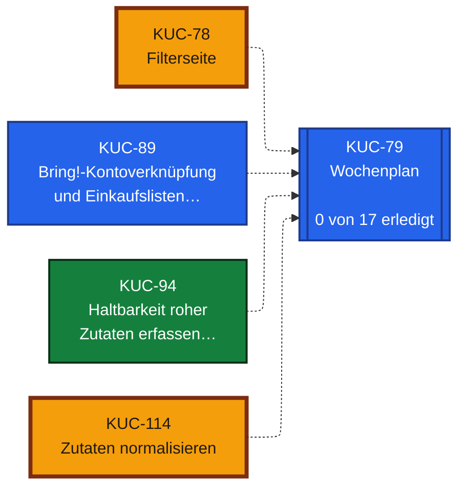
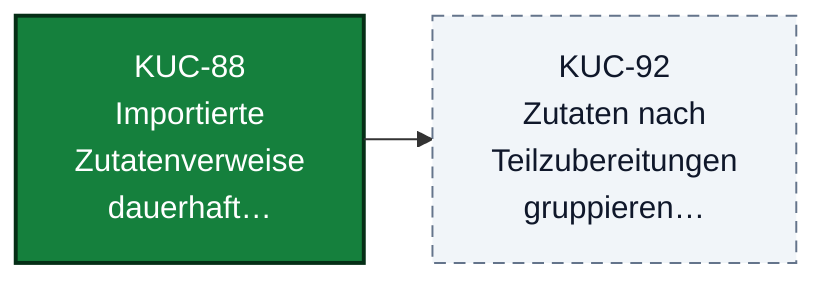
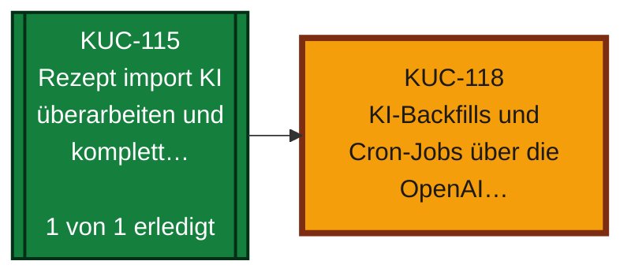
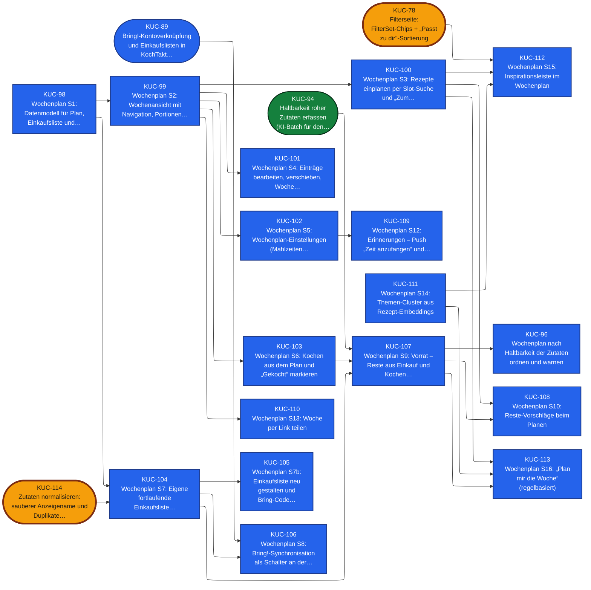

<!-- gameplan:generated
  AUTOMATISCH ERZEUGT. Diese Datei nicht von Hand pflegen.
  Quelle der Wahrheit (SSOT) ist YouTrack, Projekt KUC: https://youtrack.tecfriends.de/projects/KUC
  Status, Epics und Abhängigkeiten in YouTrack ändern, dann mit dem Skill `gameplan` neu erzeugen:
    python3 ~/.agents/skills/gameplan/scripts/gameplan.py
  Der Bereich zwischen gameplan:start und gameplan:end wird bei jedem Lauf überschrieben.
-->

# KüchenTakt — GAMEPLAN

<!-- gameplan:start project=KUC -->
Quelle: [YouTrack-Projekt KUC · KüchenTakt](https://youtrack.tecfriends.de/projects/KUC) – erzeugt von gameplan.py, nicht von Hand ändern.

52 erledigte Tickets ausgeblendet. Done bleibt in offenen Abhängigkeitsgruppen sichtbar; vollständig erledigte Gruppen entfallen. Vollständiger Stand: `--include-done`.

## Nicht einsortiert

Tickets ohne Epic und ohne Abhängigkeit.

| Ticket | Titel | Typ | Status |
|---|---|---|---|
| [KUC-14](https://youtrack.tecfriends.de/issue/KUC-14) | Werbespots/Monetarisierung implementieren | Task | Ideas |
| [KUC-50](https://youtrack.tecfriends.de/issue/KUC-50) | QR-Code auf Rezept-Detail: Schnell aufs Handy wechseln | Task | Ideas |
| [KUC-51](https://youtrack.tecfriends.de/issue/KUC-51) | Allergien-Filter: Rezepte nach unverträglichen Zutaten ausschließen | Task | Ideas |
| [KUC-54](https://youtrack.tecfriends.de/issue/KUC-54) | Weekly Newsletter E-Mail-Template fertigstellen | Task | Ideas |
| [KUC-55](https://youtrack.tecfriends.de/issue/KUC-55) | QR-Code zum Handy-Wechsel auf Rezept-Detail | Task | Won't Do |
| [KUC-56](https://youtrack.tecfriends.de/issue/KUC-56) | Allergien-Filter: Rezepte nach Zutaten-Blacklist ausschließen | Task | Won't Do |
| [KUC-59](https://youtrack.tecfriends.de/issue/KUC-59) | feat: Subscription system with Stripe (Free / Plus / Pro tiers) | Task | Ideas |
| [KUC-61](https://youtrack.tecfriends.de/issue/KUC-61) | Statische Seiten via Markdown-Dateien rendern (Catch-All Route) | Task | Ideas |
| [KUC-65](https://youtrack.tecfriends.de/issue/KUC-65) | ideas: Future Community Features & Enhancements | Task | Ideas |
| [KUC-70](https://youtrack.tecfriends.de/issue/KUC-70) | Tutorials Dashboard / Seite Entdecken – Interaktive Onboarding-Tutorials für Key Features | Task | Ideas |
| [KUC-71](https://youtrack.tecfriends.de/issue/KUC-71) | Feature Blog System – MDX-basierte Posts mit Email-Notification bei Neuveröffentlichung | Task | Ideas |
| [KUC-72](https://youtrack.tecfriends.de/issue/KUC-72) | Research REWE basket integration for recipe ingredients | Task | Ideas |
| [KUC-73](https://youtrack.tecfriends.de/issue/KUC-73) | Profil-Teaser: einfache Textformatierung (fett/kursiv) mit Buttons | Task | Ideas |
| [KUC-76](https://youtrack.tecfriends.de/issue/KUC-76) | Release: Go Live — Hauptdomain + Domain-Switchover | Task | Backlog |
| [KUC-77](https://youtrack.tecfriends.de/issue/KUC-77) | Refactoring: ViewerStore — Timer & Completion State aus React Reducer in External Store | Task | Backlog |
| [KUC-80](https://youtrack.tecfriends.de/issue/KUC-80) | Panda CSS Config Recipes: Benannte CSS-Klassen fuer alle Komponenten | Task | Ideas |
| [KUC-81](https://youtrack.tecfriends.de/issue/KUC-81) | Curated Recipe Collections mit MDX Blog-Posts | Task | Doing |
| [KUC-82](https://youtrack.tecfriends.de/issue/KUC-82) | Activity/Events System Vollausbau — Konsolidierung + neue Events | Task | Todo |
| [KUC-83](https://youtrack.tecfriends.de/issue/KUC-83) | Thumbnail Route Rework: Pfad-basierte URLs statt Query-Parameter | Task | Todo |
| [KUC-84](https://youtrack.tecfriends.de/issue/KUC-84) | Category Page Redesign — Discovery Hub mit Sidebar, Seasonal Teaser, Activity Feed | Task | Doing |
| [KUC-85](https://youtrack.tecfriends.de/issue/KUC-85) | Refactor: Activity-Type Registry als Single Source of Truth | Task | Todo |
| [KUC-87](https://youtrack.tecfriends.de/issue/KUC-87) | "Rezepte Entdecken" — Tinder-Style Recipe Swiper | Task | Ideas |
| [KUC-91](https://youtrack.tecfriends.de/issue/KUC-91) | Eigenen SMTP-Mailversand einführen und Admins über neue Rezepte informieren | Task | Todo |
| [KUC-93](https://youtrack.tecfriends.de/issue/KUC-93) | UI-Neuvision mit Hallmark: moderne Gestaltung und verlässliche Navigation | Task | Ideas |
| [KUC-95](https://youtrack.tecfriends.de/issue/KUC-95) | HelloFresh-Rezepte per URL importieren | Task | Backlog |
| [KUC-119](https://youtrack.tecfriends.de/issue/KUC-119) | Feature-Schalter im Admin-Panel verwalten und Flipt ablösen | Task | Todo |
| [KUC-120](https://youtrack.tecfriends.de/issue/KUC-120) | Lane-Viewer überarbeiten: mobil eine Spalte, ruhigere Farben, dezentere Zutaten | Task | Todo |
| [KUC-121](https://youtrack.tecfriends.de/issue/KUC-121) | Moderatoren-Benachrichtigung und Import-Protokoll suchen Rollen in Großschreibung | Bug | Todo |

**Legende**

- Status: `todo` geplant (blau, gefüllt) · `doing` in Arbeit (orange, dicker Rahmen) · `done` erledigt (grün, gefüllt) · blass mit gestricheltem Rahmen: `ideas` Ideen · `backlog` Backlog · `wontdo` verworfen · `unknown` Status ohne Zuordnung
- `A --> B`: B hängt von A ab (A muss zuerst fertig sein).
- `A -.-> B` (nur Übersicht): abgeleitet – ein Unterticket von B hängt von A oder einem Unterticket von A ab.
- Epic-Fortschritt: zusätzliche Textzeile im Knoten, z. B. „5 von 8 erledigt“; verworfene Untertickets zählen nicht mit.
- Sonstige Formen: `[[Epic]]` doppelt umrandet · `[Ticket]` eckig · `([Ticket])` abgerundet = Ticket außerhalb des Epics (Detaildiagramm)
- Abhängigkeiten, die sich aus anderen Pfeilen ergeben, sind weggelassen.

## Übersicht

### Kette 1

### Kette 2

### Kette 3

### Kette 4

## KUC-62 · feat: Trophy/Achievement System for User Milestones

[KUC-62](https://youtrack.tecfriends.de/issue/KUC-62) · Ideas · 1 von 1 erledigt

Keine sichtbaren Untertickets.

## KUC-79 · Wochenplan: planen, smart einkaufen, Reste verwerten und rechtzeitig kochen

[KUC-79](https://youtrack.tecfriends.de/issue/KUC-79) · Todo · 0 von 17 erledigt

## KUC-115 · Rezept import KI überarbeiten und komplett neu importieren

[KUC-115](https://youtrack.tecfriends.de/issue/KUC-115) · Done · 1 von 1 erledigt

### Ohne Abhängigkeiten

| Ticket | Titel | Typ | Status |
|---|---|---|---|
| [KUC-117](https://youtrack.tecfriends.de/issue/KUC-117) | Importer verlinkt Zutaten mit Umlaut am Anfang und in Pluralform nicht | Bug | Won't Do |
<!-- gameplan:end -->
